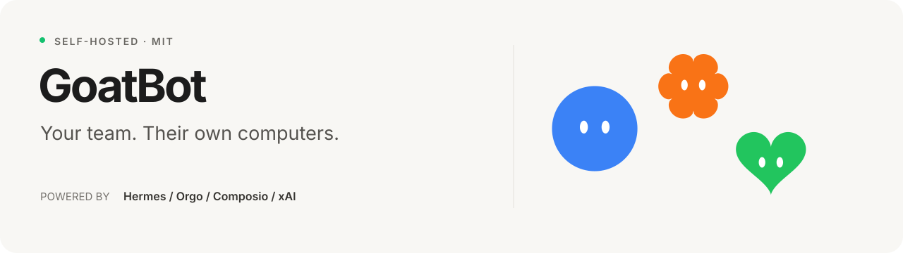
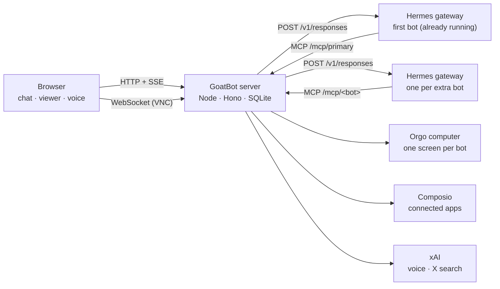

<p align="center">
  
</p>

<p align="center">
  A team of AI agents you chat with, each with its own screen on one cloud computer.<br>
  <a href="https://github.com/NousResearch/hermes-agent">Hermes Agent</a> runs the bots, <a href="https://orgo.ai">Orgo</a> gives them screens, <a href="https://composio.dev">Composio</a> connects their apps, and <a href="https://x.ai">xAI</a> gives them a voice and research on X.
</p>

<p align="center">
  <a href="#what-you-get">What you get</a> ·
  <a href="#how-it-fits-together">How it works</a> ·
  <a href="#install-on-the-computer">Install</a> ·
  <a href="#run-it-locally">Run locally</a> ·
  <a href="docs/ARCHITECTURE.md">Architecture</a> ·
  <a href="#status-and-limits">Limits</a>
</p>

<p align="center">
  
  
  
</p>

---

> **About this project.** GoatBot is a fork of [bot-hq](https://github.com/nickvasilescu/bot-hq) by [Nick Vasilescu](https://github.com/nickvasilescu), released under the MIT license. This fork renames the app, replaces the Grok Bot artwork with original artwork, and is where my own changes live. Credit for the original design and code goes to Nick.

Give a bot a job, connect the apps it needs, and follow its work in chat. Each bot has a name, a look, its own memory, and a screen you can watch or take over. Bots can message each other, run recurring tasks, and talk with you over voice.

The interface is modeled on Grok Bot. Underneath, every bot is a Hermes agent, so it can run on the model subscriptions you already pay for (Claude, ChatGPT, Grok and others) or on API keys.

## What you get

| | |
|---|---|
| **Chat that shows the work** | While a bot works you see what it is doing right now, how long it has been at it, and each step it took. Finished turns fold into a "Worked for 2m 10s · 7 steps" chip you can open. |
| **A screen per bot** | Every bot has its own desktop on the shared computer. Watch it live in the side panel, open it full size, or take control with your own mouse and keyboard. |
| **Your existing Hermes agent, kept as it is** | The first bot is the Hermes agent already running on the computer. Its messaging channels, skills and memory keep working; the app only calls its API. |
| **Connected apps with approvals** | Bots ask for the app they need and you connect it through Composio. Actions that write (send, post, delete) wait for your OK on a card in the chat. |
| **Approvals for shell, browser and desktop** | Shell commands, code, opening a site and mouse-and-keyboard control wait for your OK too. See [Approvals](#approvals). |
| **Model and subscription per bot** | Pick the provider and model in the bot's Engine panel, or sign in to a subscription on the bot's own screen. |
| **Voice** | Talk to a bot with xAI's realtime voice modes. Real work is handed to the same bot, with the same memory and tools. |
| **Research on X** | Every bot has an `x_search` tool, backed by xAI. |
| **Routines, tasks and a Library** | Recurring jobs on a schedule, a task list per bot, and a place where bots save the files they make. |

<sub>To see the chat UI with sample data, run the dev server and add <code>?fixtures</code> to the URL.</sub>

## How it fits together



- **One computer, one screen per bot.** All bots live on a single Orgo Linux computer. The first bot uses the computer's main screen; each further bot gets an Orgo screen of its own. Orgo allows four screens per computer, so four bots.
- **The first bot is the Hermes agent that already runs on that computer.** The app talks to its gateway and never restarts it or rewrites its settings.
- **Every other bot gets its own Hermes home and gateway**, started by the app. Each has its own model, sign-in, memory, browser profile and files.
- **The app's tools reach Hermes over MCP.** The server exposes `/mcp/<bot>`. Each agent gets connected apps, `x_search`, tasks, routines, the Library, and messages to other bots.
- **Screens are dressed to look like the bot's own computer**: a light desktop with a dock, and a home screen with the bot's name and apps as Chrome's new tab page.

More detail is in the [architecture guide](docs/ARCHITECTURE.md).

### How this relates to Hermes Bot Mode

Hermes Desktop has its own Bot Mode. GoatBot uses the same Hermes engine but does **not** use Bot Mode: it has its own bot layer on top of the gateway's HTTP API.

| | GoatBot | Hermes Bot Mode |
|---|---|---|
| A bot is | A separate Hermes home (the first bot is the default profile) | A Hermes profile |
| Gateways | One per extra bot | One, serving every profile |
| Transport | HTTP, `/v1/responses` | JSON-RPC over WebSocket |
| Routines | The app's own scheduler | Hermes cron jobs |
| Bot to bot | The app's `send_to_bot` tool | Hermes' `message_agent` tool |

So bots made here do not show up in Hermes Desktop's Bots tab, and bots made there do not show up here.

## Install on the computer

The app is meant to run on the same Orgo computer as Hermes.

1. On your machine: `npm ci && scripts/pack.sh hq-app.tgz`. Copy `hq-app.tgz` and `scripts/install-on-computer.sh` to the computer.
2. In Orgo, create a public URL for port `8787` on that computer.
3. On the computer, as root:

   ```bash
   PUBLIC_URL=https://<name>.orgo.dev ORGO_COMPUTER_ID=<uuid> ALLOWED_EMAILS=you@example.com \
   KEYS_FILE=/root/keys.txt PRIMARY_CDP_URL=http://127.0.0.1:9333 \
     bash install-on-computer.sh hq-app.tgz
   ```

   `KEYS_FILE` holds `XAI_API_KEY=` and `COMPOSIO_API_KEY=` lines (and `ORGO_API_KEY=` if Hermes' own `.env` has none); it is deleted after the first install. `PRIMARY_CDP_URL` is only for a main agent that already has its own Chrome. The script installs to `/opt/hq`, adds one supervisor program (`hq-app`), and leaves Hermes alone. Running it again with a newer `hq-app.tgz` upgrades the app and keeps its settings and data.
4. Give the main agent the app's tools: `python3 /opt/hq/app/scripts/add-hq-to-hermes.py`. It adds one `mcp_servers.hq` entry to Hermes' `config.yaml`, keeps a dated copy of the file, and Hermes picks the change up without a restart. `--remove` takes it out again.
   Then put the [approval gate](#approvals) on the main agent: `python3 /opt/hq/app/scripts/add-gate-to-hermes.py` (same safety checks, `--remove` to undo). Extra bots get it automatically.
5. Open the public URL and sign in with Google. If Google sign-in is not set up yet, `bash /opt/hq/app/scripts/sign-in-link.sh you@example.com` on the computer prints a one-time sign-in link.

<details>
<summary><b>Remove everything</b></summary>

On the computer:

```bash
python3 /opt/hq/hq-screen.py undress 99                      # main screen back to how it was (99 = its X display)
python3 /opt/hq/app/scripts/add-hq-to-hermes.py --remove     # take the tools out of Hermes
python3 /opt/hq/app/scripts/add-gate-to-hermes.py --remove   # take the approval gate out of Hermes
supervisorctl stop hq-app && supervisorctl remove hq-app
rm -rf /etc/supervisor/conf.d/hq-app.conf /opt/hq /var/log/hq /root/goatbot /etc/opt/chrome/policies/managed/hq.json
```

Then delete the public URL in Orgo. Screens of the other bots are released when you delete those bots in the app.

</details>

## Run it locally

You need **Node.js 22 or newer** and a Hermes gateway with its API server on (`API_SERVER_KEY` in `~/.hermes/.env`).

```bash
git clone https://github.com/BertoSolis98/goatbot.git
cd goatbot
npm ci
cp .env.example .env      # fill in the keys; comments in the file explain each one
npm run dev -w server     # API on :8787
npm run dev -w web        # app on :5173
```

With `HQ_LOCAL=0` the server reaches the computer through the Orgo API instead of running commands on it, which is enough for development. `DEV_LOGIN=1` enables the email-only sign-in form; never set it on a public address.

`npm run build && npm start` serves the built app from the API port.

The keys you need:

| Key | Used for |
|---|---|
| `ORGO_API_KEY`, `ORGO_COMPUTER_ID` | The computer and its screens |
| `COMPOSIO_API_KEY` | Connected apps |
| `XAI_API_KEY` | Voice and `x_search` |
| `SESSION_SECRET` | Sign-in sessions and the tokens agents use to reach `/mcp` |

## Approvals

Hermes runs shell commands, code, the browser and desktop control itself, so the app never sees those calls on its own. GoatBot puts a `pre_tool_call` hook in each agent's Hermes ([`server/box/goatbot-gate.py`](server/box/goatbot-gate.py)) that asks the app ([`server/src/gate.ts`](server/src/gate.ts)) before one of these tools runs. The app answers from your saved permissions or puts an approval card in the chat.

| The agent wants to | Card | "Always allow" saves |
|---|---|---|
| Run a simple command (`ls`, `curl`, `grep`) | Shows the command | That program (`shell:ls`) |
| Run a command that deletes or changes the system (`rm`, `mv`, `chmod`, `kill`, `systemctl`, package managers, `git`), or a chained or redirected one (`&&`, `\|`, `>`, `$(…)`), or an interpreter (`bash`, `python3`, `sudo`) | Shows the command | Nothing: asked every time |
| Run code (`execute_code`) | Shows the code | Nothing: asked every time |
| Open a site in the browser | Shows the site | That site (`browser:github.com`) |
| Use browser developer tools or saved logins | Shows the action | Nothing: asked every time |
| Click, type or scroll on its screen | Shows the action | Screen control (`computer:control`) |

Taking a screenshot, reading files, searching the web and the app's own tools never ask. Saved permissions are listed in **Settings → Permissions**, where "Ask again" removes one.

How it behaves:

- **Fails closed.** If the hook can't reach the app, or the app doesn't answer, Hermes blocks the call.
- **About 4½ minutes to answer.** Hermes gives a hook at most 5 minutes; after that the card expires and the call is skipped. Sending a new message also skips any card that is still waiting.
- **Only turns the app started.** When the main agent is reached through its own channels (iMessage, the CLI), Hermes' own approval rules apply instead.
- **Hermes' own checks still run.** A command Hermes considers dangerous can still be refused by Hermes after you allow it, because the app does not answer Hermes' own approval prompts yet.
- **Sites, not clicks.** Opening a site by its address asks; following a link on a page that is already open does not.
- `GATE_COMPUTER_ACTIONS=0` in `.env` turns the gate off.

## Models and subscriptions

Open a bot's details panel, **Engine**. Pick a provider and model there. **Sign in to a subscription** opens a terminal on the bot's screen running Hermes' own sign-in for that provider (for example Claude Pro/Max), so you finish it in the viewer and the bot uses that subscription from then on. Check your provider's terms before running an agent on a consumer subscription.

## Development

```bash
npm run typecheck       # server and web
npm run build
node tests/e2e.mjs https://<your-url>    # needs DEV_LOGIN=1, or E2E_SESSION=<session cookie>
```

The e2e suite creates a temporary bot (with its own Hermes gateway and screen), exercises chat, the browser on its screen, the live viewer, connected apps, voice sessions and settings, then deletes it. It calls real providers.

```text
server/src/         API, Hermes adapter (agent/loop.ts), engines (engine.ts), MCP endpoint (mcp.ts), screens (computer.ts)
server/box/         what runs on the computer to dress a screen (desktop, dock, home screen, Chrome)
web/src/            chat, bot settings, app connections, computer viewer, voice
scripts/            pack, install, Hermes config helper, sign-in link
tests/              Playwright end-to-end test
docs/               architecture; the Orgo and xAI/Composio guides predate the Hermes engine
```

## Status and limits

- Experimental, no security audit. Bots share one computer and can reach each other's files there.
- Approval cards cover Composio write actions and, through the [approval gate](#approvals), shell commands, code, opening sites and screen control. Hermes' own "risky command" prompts are not shown in the app yet.
- Four bots at most, because of Orgo's four-screen limit.
- The screen look is an original implementation inspired by OrgoAI/bops; no code or assets from that repository are used.

## License and credits

Project code is available under the [MIT license](LICENSE). GoatBot is a fork of [bot-hq](https://github.com/nickvasilescu/bot-hq) by Nick Vasilescu, which continued from his [grokbot-clone](https://github.com/nickvasilescu/grokbot-clone). The bot avatars are generated by `web/scripts/gen-shapes.mjs` and the UI icons come from [Lucide](https://lucide.dev); third-party app logos remain the property of their owners. See [third-party notices](THIRD_PARTY_NOTICES.md).

Built with [Hermes Agent](https://github.com/NousResearch/hermes-agent), [Orgo](https://orgo.ai), [Composio](https://composio.dev), and [xAI](https://x.ai). This is an independent project, unaffiliated with xAI, Cursor/Anysphere, Nous Research or Orgo.
